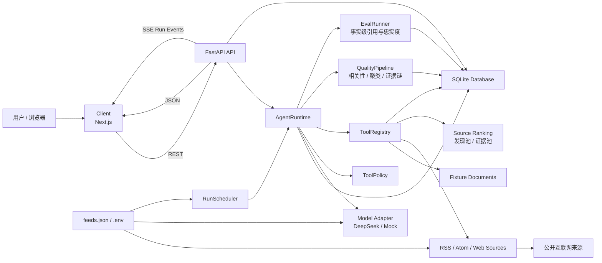
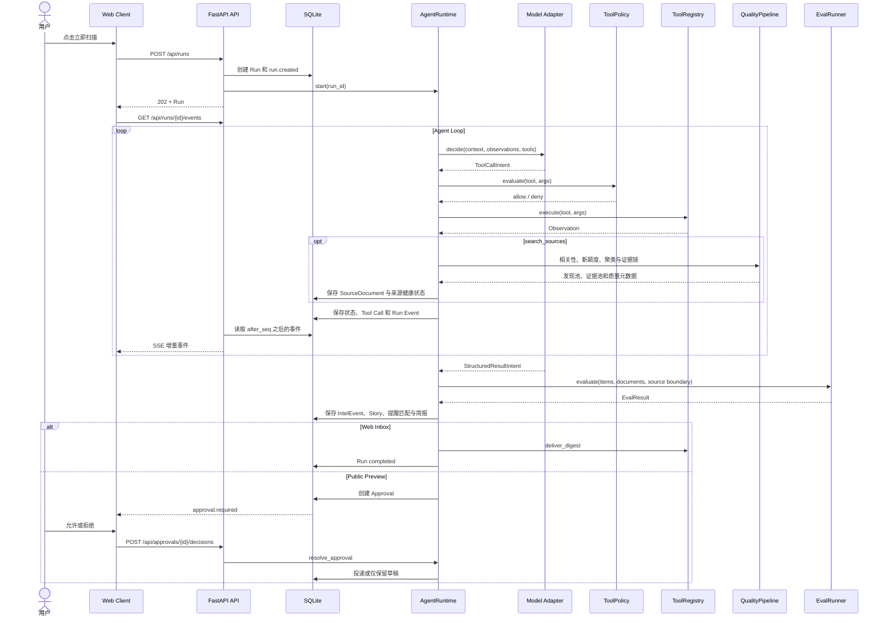

# 行业新闻简报项目架构

## 1. 文档说明

本文描述行业新闻简报当前已实现版本的项目架构，重点说明：

- 客户端与服务端的目录边界。
- 一次行业扫描从创建到生成新闻卡片的执行链路。
- 模型、工具、策略、评估和审批之间的协作方式。
- SQLite 数据模型、事件流和配置方式。
- 新增功能时应遵守的依赖方向和扩展约束。

相关文档：

- [项目 README](../README.md)
- [开发原则](./开发原则.md)
- [设计规范](./设计规范.md)

## 2. 架构目标

项目首先是一个可实际使用的行业新闻简报。Agent Runtime、Tool Policy、Eval 和
事件日志是保证采集、整理与评估可靠的内部能力，不是产品目的。架构需要同时满足：

1. **产品可用**：用户可以创建不同类型的关注、管理来源、扫描公开动态，并从卡片进入
   持续故事工作台。
2. **一事件一卡**：客户端以新闻事件为基本展示单位，多篇报道作为可追溯的来源证据，
   AI 评估附着在事件上。
3. **可验证**：最终内容通过 Schema、Source ID、事实级引用、摘要忠实度和
   Prompt Injection 边界检查。
4. **可控制**：工具受阶段、预算和参数策略限制，外部副作用必须经过授权。
5. **可替换**：真实模型与 Mock 模型、RSS 与 Fixture 数据源共享同一执行链路。
6. **可恢复**：扫描状态和事件持久化，客户端断线后可重新加载结果。
7. **质量可演进**：候选相关性、新颖度、聚类、转载关系和独立证据链均可观测、可回滚。
8. **反馈不改事实**：用户反馈只调整后续偏好和排序，不改写历史情报或证据快照。
9. **前后端解耦**：客户端只依赖 HTTP/SSE 协议，不直接依赖服务端内部实现。

## 3. 系统总览



系统分为六个主要层次：

| 层次 | 主要职责 | 核心实现 |
| --- | --- | --- |
| Web 客户端 | 选择行业、展示新闻卡片与 Markdown 详情、管理来源和扫描 | `client/app/` |
| API 层 | 提供 REST、SSE、请求校验和错误映射 | `server/app/api/` |
| Harness 层 | 编排模型、工具、策略、评估和投递 | `server/app/harness/` |
| 领域层 | 定义 Run、Intel、Story、Citation、反馈、提醒，以及质量与聚类规则 | `server/app/domain/` |
| 持久化层 | 保存业务状态和 Append-only 事件 | `server/app/persistence/` |
| 调度层 | 根据订阅计划和已启用的故事追踪频率创建幂等 Run | `server/app/scheduler.py` |

## 4. 目录结构

```text
.
├── client/                         # Web 客户端
│   ├── app/
│   │   ├── components/             # 新闻卡片、Markdown 详情、来源和运行信息
│   │   ├── RadarDashboard.tsx      # 页面状态与 API/SSE 编排
│   │   ├── radar-types.ts          # 客户端领域类型和格式化函数
│   │   ├── radar-initial.ts        # 初始行业选项与空 Dashboard 数据
│   │   ├── ai-assessment.ts        # 实验性跨新闻研判，非当前主流程
│   │   ├── editorial-layout.ts     # 历史编辑排版实验，非当前主流程
│   │   ├── page.tsx                # 页面入口
│   │   └── layout.tsx              # 根布局和站点元数据
│   ├── next.config.ts              # 同源 API 转发
│   ├── public/                     # 静态资源
│   └── package.json
├── server/                         # 行业新闻采集与 AI 整理服务端
│   ├── app/
│   │   ├── api/                    # REST 与 SSE 接口
│   │   ├── domain/                 # 领域模型、质量评分和 Story 聚类
│   │   ├── harness/                # Runtime、Model、Tools、Policy、Eval、来源排序
│   │   ├── persistence/            # SQLite Repository
│   │   ├── config.py               # 环境配置
│   │   ├── scheduler.py            # Run 调度器
│   │   └── main.py                 # 依赖装配和应用生命周期
│   └── pyproject.toml
├── test/                           # 统一测试目录
│   ├── client/                     # 客户端渲染、布局和领域辅助测试
│   └── server/                     # API、Runtime、持久化、质量和真实集成 Mock 测试
├── scripts/                        # 局域网入口和本地启动脚本
├── fixtures/
│   └── mock_documents.json         # 可重复的离线外部资料
├── data/                           # 本地 SQLite 数据，Git 忽略
├── docs/                           # 架构、设计和开发文档
├── feeds.json                      # 行业来源与搜索策略
├── .env.example
└── README.md
```

目录边界约定：

- 浏览器可执行代码、UI、客户端类型和站点构建配置只放在 `client/`。
- Python API、采集与 AI 整理 Runtime、调度和数据库访问只放在 `server/`。
- 跨客户端和服务端的本地运行脚本放在 `scripts/`。
- `feeds.json` 与 `fixtures/` 是服务端运行时使用的项目级数据配置。
- `data/` 只保存本地运行数据，不提交数据库文件。
- 客户端不能直接读取 SQLite、Fixture 或 Feed 配置，只能通过 API 获取数据。

## 5. 客户端架构

### 5.1 页面组成

`app/page.tsx` 只负责加载 `RadarDashboard`。`RadarDashboard.tsx` 是当前客户端的页面容器，负责：

- 加载 Dashboard、来源配置和自定义来源。
- 管理当前行业、新闻卡片、扫描状态和弹窗状态。
- 创建、取消和重试 Run。
- 提交 Approval 决策。
- 连接 Run SSE 流并合并增量事件。
- 在服务端不可用时展示明确空态，不生成或伪装真实新闻。

展示组件位于 `app/components/`，主要包括：

| 组件 | 职责 |
| --- | --- |
| `FocusTimeline` | 在单条新闻详情中以当前 Story 主题展示最近 30 天的三层故事脉络，高亮当前 Story，并保留其精确进展 |
| `IntelCard` | 一个 Story 一张卡，展示当前事件、来源覆盖、追踪状态、变化类型、最近三个关键故事线节点和可撤销的轻量偏好反馈 |
| `IntelDetailDialog` | 故事工作台；提供概览、时间线、观点、来源、深挖和可撤销反馈，概览正文保持稳定 Markdown |
| `RunInlineCard` | 展示当前扫描状态和主要操作 |
| `ScanCoveragePanel` | 将候选来源的层级、正文状态、质量分量、采用结果和未采用原因解释为可展开的扫描说明 |
| `RunTraceDrawer` | 辅助诊断入口，展示内部 Model、Tool、Policy、Eval 事件 |
| `CustomSourcesDialog` | 管理自定义来源；候选先执行访问、样本和关注词命中的受限试用，再由用户确认加入 |
| `OnboardingDialog` | 首次进入时选择关注领域 |
| `AIAssessmentCard/Dialog` | 历史跨新闻研判实验，不进入当前新闻信息流 |

### 5.2 客户端数据流

1. 页面先使用 `radar-initial.ts` 中的行业选项和空 Dashboard 完成初始渲染。
2. 浏览器 Hydration 后请求 `GET /api/dashboard`。
3. 服务端可访问时，用持久化订阅、Run 和 Approval 替换初始空数据。
4. 当前关注变化时，客户端通过 `GET /api/intel-events?subscription_id=...` 单独加载完整
   新闻卡片，避免依赖 Dashboard 的全局数量上限。反馈只在打开详情时按 Event 加载。
5. 客户端通过 `GET /api/runs/{run_id}/source-documents` 加载当前行业最近一次 Run 的
   候选记录，按 `selected`、`reviewed`、`deferred`、`blocked` 汇总扫描漏斗；用户可展开
   查看关注层级、正文获取情况、入选质量均值和基于已保存质量信号生成的未采用原因。
   `source-health` 与 `source-query-metrics` 同时补充近期来源可用性和检索覆盖，但不把
   历史来源健康误写成本次 Run 的单次错误。
6. 用户发起扫描后，客户端调用 `POST /api/runs`。
7. 客户端为每个 `queued` / `running` Run 分别连接
   `GET /api/runs/{run_id}/events`，实时接收 SSE；同一关注存在活动 Run 时禁止重复创建，
   其他关注仍可发起扫描并在执行槽满时进入队列。
8. 各 Run 完成、失败、取消或等待审批时只关闭自身 SSE，并重新加载当前行业；切换关注
   不会中断其他 Run 的状态追踪。
9. SSE 中断后，可通过 `/events/history` 恢复完整事件历史。
10. 打开详情后，并行加载 Story 详情、精确时间线、Event 反馈和最近 30 天的三层故事脉络；
    Subscription 只限定候选范围，当前 Story 的主题与事件轴决定分层。当前 Story 默认高亮为
    核心；若预计、传闻或时间安排已经被高可信度事实兑现、取消或纠正，则标为已更新前情，
    后续事实成为核心。多事件 Story 在当前节点内继续显示精确进展。
11. 用户发起故事深挖时，客户端用 `research_mode=deep_dive`、当前 `story_id` 和
    `research_focus` 创建 Run；`research_focus` 可取全面、最新进展、官方信源、不同观点
    或历史背景，SSE、排队、取消、失败和完成仍复用普通扫描链路。
12. 客户端以最近一次已完成的常规监测 Run 的 `result.item_ids` 为边界，把本轮事件分成
    新 Story 和已有 Story 的实质进展；未进入本轮结果的历史卡片折叠保留。运行中、失败或
    缺少完成快照时不推测“没有变化”。

客户端按 `IntelEvent.story_id` 聚合不同 Run 的相关事件，并把聚合后的
`IntelEvent.sources` 作为同一张主卡的相关报道。卡片使用事件标题、AI 摘要、重要度和
可信度；详情保留每篇报道的原始标题、媒体、发布时间、事实级引文和链接。`story_id`
只建立报道关系，不改写各 Run 的事实、引用和来源快照。

分类协议固定为 `news`、`funding`、`technology`、`event`、`interview` 和 `content`。Model
Adapter 在 Prompt 中约束输出，领域模型在 Eval 和数据库读取边界统一归一化历史值；
每个 `IntelSource` 还会根据原始新闻标题获得独立分类，避免一个聚类中的访谈、活动等
不同来源全部沿用事件主分类。`content` 用于段子、梗、视频等可直接消费的公开内容本身，
关于这些内容的报道仍归入 `news`。客户端只负责把这六个稳定值显示为中文标签。

客户端本地存储仅用于设备级交互状态和短期缓存：

- `signal-radar-following-v2`：用户关注的行业。
- `signal-radar-custom-sources-v1`：自定义来源的最近缓存。
服务端 SQLite 才是 Run、候选新闻、情报、Story、自定义来源、反馈、订阅偏好、
提醒、简报和 Approval 的权威数据源。

### 5.3 类型边界

`radar-types.ts` 定义客户端使用的 API 数据结构，包括：

- `Subscription`
- `Run`
- `RunEvent`
- `SourceDocument`
- `IntelEvent`
- `IntelCitation`
- `IntelFeedback`
- `Approval`
- `DashboardData`
- `SourceProfile`

服务端领域模型发生字段变化时，应同步更新该文件，并检查新闻卡片、Markdown 详情、
运行信息和初始空数据。

### 5.4 构建与运行

客户端使用 Next.js App Router，生产构建由 Node.js 启动。

- `next.config.ts` 将同源 `/api` 转发到 FastAPI。开发启动或生产构建时可用 `RADAR_API_URL` 指定目标。
- 配置 `NEXT_PUBLIC_API_BASE_URL` 时，浏览器直接请求指定的 API 地址。
- FastAPI 通过 SQLite 管理行业情报业务数据。

## 6. 服务端架构

### 6.1 应用组合根

`server/app/main.py` 是服务端依赖装配入口，负责创建：

- `Settings`
- `Database`
- `ToolRegistry`
- `ResearchModelAdapter`
- `ToolPolicy`
- `EvalRunner`
- `AgentRuntime`
- `RunScheduler`

这些对象被保存到 `app.state`，由 API 层在请求期间获取。

应用启动时依次执行：

1. 初始化 SQLite 表。
2. 对账进程中断时遗留的运行中 Run。
3. 写入预置行业订阅。
4. 启动 Scheduler。

应用关闭时停止 Scheduler、取消仍在运行的 Agent Task，并关闭模型 HTTP Client。

### 6.2 API 层

`server/app/api/routes.py` 按资源提供接口：

| 资源 | 主要接口 | 作用 |
| --- | --- | --- |
| 系统 | `/health`、`/api/system/status` | 健康检查与非敏感运行配置 |
| Dashboard | `/api/dashboard` | 聚合页面首屏所需数据 |
| 订阅 | `/api/subscriptions` | 查询和创建行业订阅 |
| Story 上下文 | `/api/stories/{story_id}/context-timeline` | 以当前 Story 的主题和事件轴为锚点，在同一关注候选范围内查询核心、相关和周边动态；默认 30 天，可请求 7–90 天 |
| 来源 | `/api/source-profiles`、`/api/custom-sources`、`/api/custom-sources/preview` | 查询配置来源；受限试用候选来源；确认后管理自定义来源 |
| 候选新闻 | `/api/source-documents`、`/api/runs/{id}/source-documents` | 查询发现池、证据池结果和质量元数据 |
| 来源诊断 | `/api/source-health`、`/api/source-query-metrics` | 查询来源健康和 AI 检索效果 |
| Run | `/api/runs`、取消、重试 | 创建和控制 Agent Run |
| 事件 | `/events`、`/events/history` | SSE 增量事件与历史事件 |
| 情报 | `/api/intel-events` | 查询结构化情报 |
| Story | `/api/stories`、`/{story_id}`、`/timeline` | 查询持续事件、关系、证据链和时间线 |
| 反馈与偏好 | Event `/feedback`、Subscription `/preferences` | 在详情中读取、创建或撤销 Event 反馈，管理订阅级权重 |
| 提醒与简报 | `/api/alerts`、`/matches`、`/api/digests` | 管理站内提醒并读取周期简报 |
| 审批 | `/api/approvals`、`/decisions` | 查询和处理公开投递审批 |
| 调度 | `/api/scheduler/tick` | 手动触发一次调度检查 |

API 层只负责协议、参数验证、资源查询和任务触发，不包含模型决策或工具编排逻辑。

### 6.3 领域层

`server/app/domain/models.py` 使用 Pydantic 定义系统内部和 API 输出共享的领域对象。

核心聚合包括：

- `Subscription`：关注名称、类型、领域、主题、关键词、回看窗口、最低重要度和调度时间；
  `focus_type` 取行业、公司、人物、团队、体育、内容娱乐、产品、技术或事件之一，
  `focus_domain` 独立保存综合、体育、汽车、科技、娱乐、财经或医疗健康领域。对象类型用于
  决定关系结构，所属领域用于选择垂直来源；自动识别只在创建和一次性迁移时执行。
- `FocusProfile`：从订阅别名、配置关键词和已确认偏好派生的运行时对象画像。关系保存
  `related/context` 层级与来源（配置、反馈或观察）；观察到的关系和来源先进入建议区，
  不直接修改订阅或扩大采集范围。候选来源试用结果使用 `CustomSourcePreview` 表达访问状态、
  采集方式、有限样本、关注词命中和最近发布时间，不在确认前写入自定义来源。
- `Run`：一次 Agent 执行的目标、状态、阶段、预算、用量和结果；`research_mode` 区分
  常规监测与故事深挖，深挖通过 `story_id` 绑定目标 Story，并通过 `research_focus`
  持久化本次调查路线。
- `RunEvent`：Run 的顺序事件，使用 `run_id + seq` 保证稳定顺序。
- `SourceDocument`：候选新闻索引、发现/证据池结果、相关性与新颖度分量、聚类和证据链。
- `IntelEvent`：通过 Eval 后的结构化情报、变化摘要和独立证据链数量。
- `StoryContextTimeline` / `StoryContextTimelineItem`：以当前 Story 的主题和事件轴为锚点、从
  已保存 IntelEvent 派生的详情页故事脉络读模型；模型同时返回关注主体与当前主题，保存 Story
  边界，只增加核心、相关和周边展示分级。
- `IntelFact` / `IntelCitation`：事实、最短必要引文、哈希、段落定位和支持/冲突关系。
- `IntelSource`：来源元数据、原始正文、可选中文译文、内容来源类型和五类新闻分类。
- `Story` / `StoryRelation` / `StoryDocument`：持续事件、跨事件关系和来源证据图。
- `IntelFeedback` / `SubscriptionPreferences`：不改写事实的用户反馈与订阅级可解释偏好。
- `AlertRule` / `AlertMatch` / `Digest`：站内提醒规则、匹配结果和周期简报。
- `Approval`：受策略保护动作的审批请求及决策。

Run 状态：

```text
queued
  → running
      → completed
      → failed
      → cancelled
      → waiting_approval
          → running → completed
          → completed（拒绝投递，仅保留草稿）
```

领域模型定义的 Run 阶段：

```text
planning → collecting → extracting → clustering
         → verifying → synthesizing → evaluating → delivering
```

当前 Runtime 主链实际切换：

```text
planning → collecting → clustering → verifying
         → synthesizing → evaluating → delivering
```

正文提取仍由采集工具在 `collecting` 内完成，并通过 `extraction.completed` 单独记录；
候选质量分析和事件聚类已进入显式 `clustering` 阶段。`extracting` 仍保留为领域枚举，
便于未来把全文提取拆成独立可恢复步骤。阶段既表达执行进度，也限制当前可见的工具。

### 6.4 Harness 层

#### AgentRuntime

`harness/runtime.py` 是内部扫描编排器。每个 Run 对应一个进程内 `asyncio.Task`；
Runtime 默认同时执行 2 个 Run，更多 Run 保持 `queued` 并记录 `run.queued` 事件，
执行槽释放后按等待顺序继续。并发上限可通过 `INTEL_RADAR_MAX_CONCURRENT_RUNS` 调整。
执行期间循环：

1. 读取 Run 和订阅。
2. 检查取消标记与模型步骤预算。
3. 根据当前 Observation 决定下一批可见工具。
4. 调用 Model Adapter 获得 `ToolCallIntent` 或 `StructuredResultIntent`。
5. 对工具调用执行 Policy 检查。
6. 执行工具并把结果加入 Observation。
7. `search_sources` 完成后计算相关性、新颖度、聚类和独立证据链，保存完整发现池。
8. 获得结构化结果后运行事实级 Eval，并按独立证据链校准可信度。
9. 保存 IntelEvent、Story、提醒匹配和简报，再执行投递或创建 Approval；深挖 Run 的
   新事件在质量门禁通过后追加到目标 Story，不绕过 Eval 或改写历史事件。

Runtime 不直接抓取 RSS、不直接调用模型 HTTP API，也不直接拼装 SQL；这些能力分别由 Tool Registry、Model Adapter 和 Database 提供。

#### Model Adapter

`harness/model_adapter.py` 提供统一的 `ResearchModelAdapter` 接口：

- `OpenAICompatibleResearchModelAdapter`：调用 OpenAI-compatible Chat Completions API，
  兼容 JSON 代码块和说明文字包裹，并识别长度截断。最终 JSON 无效、被截断或不符合
  Schema 时记录失败事件，再由 Runtime 使用当前 Run 已采集的证据显式降级，不让整次
  扫描因展示格式问题作废。
- `MockResearchModelAdapter`：按固定步骤产生工具调用和结构化结果，用于离线演示与回归测试。

当前本地真实配置以 `deepseek-v4-pro` 为主模型，`deepseek-v4-flash` 仅作为明确的降级
候选；模型切换不改变 Runtime、Policy、Eval 或工具链路。

两个适配器返回相同的 `ModelDecision`，因此 Runtime 不关心模型提供商。

#### Tool Registry

`harness/tools.py` 注册四个工具：

| 工具 | 作用 |
| --- | --- |
| `list_configured_sources` | 返回当前行业允许使用的来源及可信度元数据 |
| `search_sources` | 从 Fixture、RSS、Atom、网页或 AI 检索来源构建发现池和有限证据池 |
| `query_intel_history` | 查询当前行业已有情报，用于历史关联和去重 |
| `deliver_digest` | 将通过 Eval 的情报投递到允许的渠道 |

Tool Registry 负责工具 Schema、分发、执行耗时统计和结果格式，但不决定工具是否允许执行。

#### Tool Policy

`harness/policy.py` 在工具执行前检查：

- 工具是否在当前 Run 阶段可见。
- 工具调用和搜索调用是否超出预算。
- 搜索参数是否合法。
- 投递渠道是否允许。
- `public_preview` 是否需要 Approval。

当前主要阶段权限：

| Run 阶段 | 允许的工具 |
| --- | --- |
| `planning` | `list_configured_sources` |
| `collecting` | `list_configured_sources`、`search_sources` |
| `clustering` | 无外部工具；只运行 Runtime 内质量与聚类步骤 |
| `verifying` | `search_sources`、`query_intel_history` |
| `synthesizing` | `query_intel_history` |
| `delivering` | `deliver_digest` |

#### Eval Runner

`harness/evals.py` 是保存和投递前的质量门禁，检查：

- 模型输出是否符合 `IntelEventDraft` Schema。
- 引用的 Source ID 是否来自当前 Run。
- 疑似 Prompt Injection 来源是否进入最终情报。
- 事实、推断与结构化 Citation 是否包含在事件顶层 `source_ids`。
- 每条事实是否有正文中可定位、哈希一致的支持引文。
- 引文与事实关键数字是否冲突；冲突事件必须标记 `conflicting` 并降低可信度。
- 摘要中的关键数字是否可以回溯到当前事件来源。
- 相关性、Story 一致性、新颖度和证据独立性软指标。

模型产出了草稿但任一硬检查失败时，Run 进入 `failed`，不会保存成功结果或进入投递
阶段；模型明确返回零条事件且空集合 Eval 通过时，Run 以 `NO_QUALIFYING_INTEL`
完成，写入 `run.no_results`，并跳过无内容投递。软检查进入 `eval.completed` 指标，
不通过改写历史事件制造成功。

#### RSS Source Collector

`harness/rss_sources.py` 负责真实来源采集：

- 读取 `feeds.json` 的行业 Source Profile。
- 展开 `$source_groups` 中可复用的论坛、证券、投融资、峰会、沙龙和行业媒体来源，
  与行业专业来源按 Source ID 去重；每个内置行业当前至少展开为 19 个定向来源。
- 对没有内置 Profile 的自定义关注执行 `$automatic_source_rules`：行业、公司、人物等类型
  先获得基础公开来源，再按持久化 `focus_type` 和名称、主题、关键词叠加行业或垂直来源；
  产品关注改用精确产品检索和用户自定义来源，避免通用新闻源带入大量品类噪声。创建后的来源
  画像与每次扫描使用同一个解析函数，因此新增领域只需扩展配置规则，不在 Runtime 中增加特例。
- 内置行业执行各自维护的 8 组 AI 新闻检索模板；自定义关注通常根据持久化的 `focus_type`
  选择 8 组类型专属模板。产品模板覆盖发布、价格销量、交付、更新、质量安全、评测，以及
  与母公司和生态的明确关系；“汽车”“手机”等宽泛品类词不单独构成相关性。人物或历史通用
  类型若从名称、主题和关键词中识别出明确体育
  语境，会同时启用体育垂直来源；体育人物使用人物动态与比赛、阵容、伤病、复出、赛程及
  英文比赛词组合成的 8 组混合查询，避免类型标签遮蔽实质领域。字符串和对象配置在加载时
  统一转换为带稳定 ID、配额和优先级的 `SearchQueryTemplate`，候选与查询产出指标都按该
  ID 归因。
- 每个检索模板额外保存 `focus_tier`：`core` 查询对象本身，`related` 查询已确认的一级
  关系，`context` 查询行业、生态或同集团业务。模板层级记录“为什么搜到”，文档层级由正文
  对核心别名、一级关系和二级背景的实际命中重新计算，二者不能互相冒充。
- `followed_entities` 保存用户确认的一级关系，`context_entities` 保存用户确认的二级背景；
  二者在下一次扫描中分别扩展相关和周边查询。跨至少两个 Story 重复出现的标签及可靠来源
  只生成受控建议，用户确认关系或添加来源后才进入正式画像。
- 常规监测以关注名称作为 8 组模板的 `{focus}`；故事深挖以服务端保存的 Story 标题与
  `research_focus` 对应的限定词替换 `{focus}`，使全部 8 组都围绕本次调查路线展开，
  不信任模型自行提供的泛化标题。
- 请求 RSS/Atom、配置的公开网页和新闻聚合检索 Feed。
- 合并行业关键词、订阅关键词和排除词，过滤同名歧义与常见噪声。
- 检查 HTTPS、主机、重定向、响应大小、内容类型和超时。
- 对 Feed 使用 ETag、Last-Modified 和两小时重叠窗口进行增量抓取；`304 Not Modified`
  不重复提取正文，并持续保存成功、失败、产出、延迟和全文提取状态。
- 发现自定义站点的 Feed 或站内文章链接。
- 自定义来源确认前使用同一 URL 安全和有界响应规则执行试用，只读取有限标题样本并计算
  当前关注词命中；试用不创建 Run、不调用模型，也不自动激活来源。
- 在允许的来源主机范围内抓取高优先级文章，并受控解析聚合器原始文章链接。
- 使用 Trafilatura 提取正文、作者和主图。
- 标记可疑 Prompt Injection 内容。
- 抓取失败时回退到 Feed 摘要。

外部正文在整个 Harness 中始终标记为不可信数据，不能作为系统指令。
来源运行状态分为 `healthy`、`degraded`、`failing` 和 `stale`；状态变化追加诊断事件，
不会静默删除来源或修改历史 Run。

#### Source Ranking

`harness/source_ranking.py` 把采集结果分为发现池和有限证据池：

- 默认最多保存 96 条发现候选、选取 30 条模型证据，并只为优先候选尝试最多 36 次全文提取；
  三个上限相互独立且均可配置，扩大召回不会自动扩大模型上下文。
- 先按规范化 URL 去重，再综合关键词命中、可靠度、新颖度、时效、来源直接性和正文完整度排序。
- 按官方核心源、行业媒体、AI 检索、政策/资本/活动和社区设置软配额。
- 同时执行单来源与单发布方上限，未使用配额回流给剩余高分候选。
- 产品关注先保留直接提及产品的候选，再用同时提及产品及母公司、生态或供应商的候选补充；
  只命中母公司、手机等关联主体但未说明产品关系的内容不进入证据池。
- 候选正文按对象距离标记 `core/related/context/unmatched`，相关性总分加入对象关系分；
  周边候选必须同时达到可靠度和基本相关性门槛。关注实体获得正向偏好，周边实体获得较小
  正向偏好，屏蔽实体或来源获得负向偏好或直接退出证据池。
- 排序分数、分量、来源分组和入池理由随候选保存；安全标记是硬边界，未进入证据池的
  安全候选仍以 `deferred` 保存，供诊断和后续评估。

#### Quality Pipeline 与 Story Clustering

`domain/quality_pipeline.py` 在证据合成前运行：

- 分别保存关键词、实体、轻量语义、来源先验和用户偏好分，再计算相关性总分。
- 产品关注以产品名、型号别名和明确关联主体作为有效关键词，忽略宽泛品类词的直接加分。
- 独立保存 URL、内容、Story、关键数字和动作变化的新颖度分量。
- 提取主体、动作、对象、地区、时间、数字和事件类型，使用确定性相似度生成聚类候选。
- 区分 `same_event`、`follow_up`、`duplicate`、`related`、`unrelated` 和模糊待复核关系。
- 按官方、原创/报道、转载、聚合和评论关系生成证据链及独立性分数。
- 为事实选择最短必要引文，保存 Source ID、哈希、段落定位和支持/冲突关系。

`domain/story_clustering.py` 负责跨 Run 的保守 Story 匹配和 `follow_up` / `related`
关系识别。主体冲突或证据不足时保留独立 Story，优先避免错误合并。

`domain/focus_timeline.py` 在详情读取时先用 Subscription 限定候选范围，再以当前 Story 的主题
标签与事件轴计算关系：当前 Story 固定为 `core`，同主题同事件轴为 `core`，相邻事件轴为
`related`，同主题背景为 `context`，缺少主题关联的宽泛命中项不展示。人物、公司、体育、内容
娱乐、产品、技术、行业和具体事件共用同一协议，不修改 IntelEvent、Story 或来源证据。具体
Story 仍由保守聚类决定，多次进展嵌入当前节点继续展示。

#### 反馈、提醒与简报

质量链路通过后再产生用户侧衍生能力：

- Event 反馈可撤销且幂等；“多看这类 / 少看这类”位于详情，只更新订阅偏好统计并影响
  后续 Run 的可解释排序权重，不改写当前事件。
- Story 时间线由不可变的 IntelEvent 快照组成，`change_summary` 只比较已保存的新旧证据。
- Alert Rule 只匹配已通过 Eval 的事件；首期提醒只保存为站内 `alert_matches`。
- 日报和周报只聚合已保存的 IntelEvent / Story，不重新抓取来源或生成无证据事实。
- 质量可观测、Story 聚类、事实级 Eval 和个性化由独立配置开关控制；关闭开关不会删除
  Story、反馈、候选或 Append-only 事件。

### 6.5 Scheduler

`server/app/scheduler.py` 支持：

- `每天 HH:MM`
- `工作日 HH:MM`

Scheduler 根据订阅、日期和时间槽生成稳定的 `idempotency_key`。同一时间槽重复 Tick 会返回已有 Run，不会重复创建任务。Scheduler 默认关闭，避免开发环境意外产生模型费用。

## 7. Run 核心调用链



## 8. 持久化架构

当前使用 SQLite，主要表如下：

| 表 | 关系与职责 |
| --- | --- |
| `subscriptions` | 关注订阅配置及 `focus_type`、`focus_domain`；一条订阅对应多个 Run 和自定义来源 |
| `runs` | Agent 执行实例；保存 `research_mode`、可选 `story_id`、`research_focus`、状态、阶段、预算、用量、结果和错误 |
| `run_events` | Append-only 执行事件；按 Run 内 `seq` 排序 |
| `tool_calls` | 工具意图、Policy 决策、精简结果、错误和耗时 |
| `source_documents` | 按规范化 URL 去重的候选新闻、受限摘要、排序分量、聚类和证据链元数据 |
| `source_runtime_states` | 来源 ETag/Last-Modified、成功/失败、发现/入选和全文提取健康指标 |
| `run_documents` | Run 与候选新闻的关联，以及 discovered、deferred、selected、reviewed、blocked 结果 |
| `intel_events` | 通过 Eval 后的事实、Citation、来源快照、变化摘要和证据链数量 |
| `stories` | 持续事件当前指针、主体、类型、首末事件时间和稳定指纹 |
| `story_relations` | Story 间的 same_event、follow_up、duplicate、related 等关系 |
| `story_documents` | Story 与来源文档、转载角色和独立证据链的关联 |
| `intel_feedback` | 用户对情报的可撤销、幂等反馈；不修改历史事实 |
| `subscription_preferences` | 分类、实体、来源权重，一级关系 `followed_entities`、二级背景 `context_entities`，以及屏蔽、提醒和简报偏好 |
| `alert_rules` / `alert_matches` | 站内提醒条件及通过 Eval 的匹配事件 |
| `digests` | 基于已保存 IntelEvent / Story 生成的日报或周报 |
| `approvals` | 公开投递等敏感动作的审批记录 |
| `story_watches` | Story 的追踪问题、调查方向、频率、启停状态和最近一次检查 |
| `custom_sources` | 用户为订阅添加的 RSS 或网页来源 |

关键设计：

- Run 状态和 Event Log 分开保存：状态用于快速查询，事件用于解释过程。
- `run_events` 使用单调递增序号，支持 SSE 断线续传和历史回放。
- `runs.idempotency_key` 唯一，保证 Scheduler 时间槽幂等。
- `source_documents` 长期保存 URL、标题、内容哈希、发现时间和可解释质量分量；正文只保留
  受限摘要，事实级最短引文保存在 IntelEvent 的 Citation 快照。
- 历史 `tool_calls` 中的候选资料会在初始化时幂等回填到候选新闻表，新 Run 不再把完整
  候选正文重复写入工具结果。
- `intel_events.dedupe_key` 根据排序后的规范化来源 URL 生成，不受模型返回的来源顺序影响。
- `intel_events.story_id` 使用共享来源、时间窗口、标题相似度、共同实体和主体动作进行
  保守匹配；`stories.current_intel_event_id` 指向当前状态，历史 IntelEvent 不覆盖。
- 深挖 Run 的新事件显式写入目标 Story；数据库同时校验目标 Story 与订阅一致，已存在的
  去重事件保留原 Story，避免因重复采集改写历史归属。
- `story_documents` 用证据链 ID 区分媒体覆盖与证据独立性；多站转载同一公告只增加覆盖，
  不增加可信度使用的独立证据数量。
- `intel_events.sources` 保存来源快照及扫描时生成的可选中文译文，避免详情展示依赖后续
  网络请求或在浏览器中另行调用翻译服务。
- Feedback 更新订阅偏好统计并影响后续候选排序；创建、撤销或屏蔽操作都不会改写
  `intel_events`、`run_events` 或历史来源快照。
- 提醒和简报只在通过 Eval 并保存 IntelEvent 后生成；首期提醒只进入站内数据表，不绕过
  Delivery、Policy 或 Approval 向外部发送。
- 追踪汇总由服务端读取 Story、StoryWatch、Run、IntelEvent 和 StoryDocument 确定性聚合，
  保留给后续“我的追踪”和周报，不在行业信息流中混入行业级 Story；争议、官方来源和独立
  证据数均来自已保存证据结构。
- SQLite Repository 集中处理 JSON 序列化和 Pydantic 对象还原。

SQLite 适合当前个人使用、单进程 MVP。多用户、多 Worker 或高并发部署应迁移到
PostgreSQL，并为 Run 接管增加租约机制。

## 9. 事件与可观察性

Runtime 对关键边界写入事件，主要事件类型包括：

- Run：`run.created`、`run.started`、`run.stage_changed`、`run.no_results`、`run.completed`、`run.failed`、`run.cancelled`
- Model：`model.started`、`model.responded`、`model.completed`、`model.failed`、`model.degraded`
- Tool：`tool.requested`、`tool.allowed`、`tool.denied`、`tool.started`、`tool.completed`、`tool.failed`
- Collection：`collection.discovery_completed`、`collection.ranking_completed`、`extraction.completed`
- Quality：`quality.relevance_scored`、`clustering.completed`
- Source：`source.health_changed`
- Eval：`eval.completed`
- Approval：`approval.required`、`approval.resolved`
- Delivery：`delivery.completed`、`delivery.skipped`

事件包含：

- `actor`：事件由用户、模型、策略、工具、评估器还是 Runtime 产生。
- `payload`：当前边界的结构化结果摘要。
- `visibility`：预留用户事件与内部事件的可见性区分。
- `seq`：Run 内稳定序号。

客户端执行轨迹直接消费这些事件，因此新增运行阶段或工具边界时，应同步补充事件，而不是只写日志文本。

## 10. 配置架构

`server/app/config.py` 从环境变量和最近的 `.env` 读取配置，不覆盖已经存在的进程环境变量。

主要配置分组：

| 分组 | 变量示例 |
| --- | --- |
| 模型 | `CONTENT_AI_PROVIDER`、`CONTENT_AI_BASE_URL`、`CONTENT_AI_API_KEY`、`CONTENT_AI_MODEL` |
| 模式 | `INTEL_RADAR_MODEL_MODE`、`INTEL_RADAR_SOURCE_MODE` |
| 数据 | `INTEL_RADAR_DATABASE`、`INTEL_RADAR_FIXTURES`、`INTEL_RADAR_FEED_CONFIG` |
| 供给与网络 | Feed 超时/大小、发现池/证据池/全文上限、单来源和单发布方上限 |
| 质量开关 | 质量可观测、Story 聚类、事实级 Eval、个性化 |
| 调度 | `INTEL_RADAR_SCHEDULER_ENABLED`、时区、轮询间隔、补跑窗口 |
| Web | `INTEL_RADAR_CORS_ORIGINS`、`NEXT_PUBLIC_API_BASE_URL` |

默认模式：

- 默认使用 DeepSeek `real + rss`，并要求配置模型 API Key。
- 缺少模型 API Key 时启动失败，不会静默降级为 Mock。
- 只有显式设置 `INTEL_RADAR_MODEL_MODE=mock` 时才使用 Mock；离线开发通常同时设置
  `INTEL_RADAR_SOURCE_MODE=fixture`。

真实模式与 Mock 模式只替换适配器和数据来源，不绕过 Policy、Budget、Event Log 或 Eval。

## 11. 安全边界

当前架构包含以下安全控制：

1. 自定义来源必须使用绝对 HTTPS URL。
2. RSS 和网页抓取限制协议、主机、重定向、响应大小和超时。
3. 外部内容始终作为不可信 Observation，不进入系统指令。
4. Tool Policy 限制工具可见性、参数、预算和投递渠道。
5. Eval 阻止未知 Source ID、不可定位引文、摘要越界和可疑 Prompt Injection 来源进入情报。
6. 公开预览投递必须经过用户 Approval。
7. 用户反馈只能调整后续偏好，不能改写事实、事件轨迹或审批记录。
8. Health 和系统状态接口不返回 API Key。

当前版本仍是本地单用户 MVP，API 事件中的用户标识使用 `local_user`。在开放到公网或增加多用户能力前，需要补充服务端认证、授权、租户隔离和审计主体。

## 12. 测试架构

服务端测试：

| 文件 | 主要覆盖 |
| --- | --- |
| `test/server/test_runtime.py` | Agent Loop、工具调用、Eval、Approval、取消与失败路径 |
| `test/server/test_api.py` | Dashboard、Run、Story、反馈、偏好、提醒、简报和 API 协议 |
| `test/server/test_persistence.py` | 增量迁移、候选池、Intel/Story 去重和历史兼容 |
| `test/server/test_source_ranking.py` | 发现池/证据池、软配额、上限、排序理由和安全边界 |
| `test/server/test_quality_iteration.py` | 相关性、新颖度、聚类、证据链、Citation、反馈撤销和时间线 |
| `test/server/test_real_integrations.py` | RSS、正文提取、安全边界、模型协议、Scheduler 幂等 |
| `test/server/conftest.py` | 临时数据库、Mock 配置和共享 Harness Fixture |

客户端测试：

| 文件 | 主要覆盖 |
| --- | --- |
| `test/client/rendered-html.test.mjs` | 产品页面服务端渲染、关键内容和可访问控件 |

变更核心链路时至少验证：

- 服务端 `pytest`。
- 客户端生产构建。
- 客户端渲染测试。
- ESLint。

## 13. 扩展规则

### 13.1 新增工具

1. 在 `ToolRegistry` 添加定义和执行器。
2. 明确输入 Schema 和返回结构。
3. 在 `ToolPolicy` 配置可见阶段、预算和审批规则。
4. 在 Runtime 记录请求、决策、开始、完成或失败事件。
5. 判断是否需要新增 Eval 硬门禁。
6. 增加成功、拒绝、失败和预算耗尽测试。

### 13.2 新增 API 字段

1. 先修改服务端 Pydantic 领域模型。
2. 修改 Database 映射或迁移逻辑。
3. 更新客户端 `radar-types.ts`。
4. 更新 `radar-initial.ts`，保证首屏空态结构与客户端类型一致。
5. 补充 API 与渲染测试。

### 13.3 新增 Run 状态或事件

1. 更新服务端 `RunStatus` 或 `RunStage`。
2. 明确状态转换只能由 Runtime 或审批流程执行。
3. 产生对应的 Append-only Event。
4. 更新客户端状态类型、标签和 SSE 事件监听列表。
5. 验证断线恢复和终态关闭 SSE 的行为。

### 13.4 替换数据库

领域模型、API 和 Runtime 不应直接依赖 SQLite 语句。迁移 PostgreSQL 时，应保持 `Database` 对外方法的语义，优先替换持久化实现，再增加事务、租约和多 Worker 接管能力。

## 14. 当前边界

- Agent Task 运行在 FastAPI 进程内，不是独立 Worker。
- Run 支持单进程内受控并发，默认 2 个执行槽；这属于多个 Run 共用同一 Runtime，
  不代表多个 Agent 协作，也不提供跨进程队列。
- Scheduler 是单进程轮询器。
- SQLite 不适合多实例并发写入。
- Run 可在启动时对账，但不能从中间 Observation 继续执行；来源运行状态虽已保存在
  SQLite，尚未覆盖 Run 级断点续跑。
- 已实现轻量文本相似度 Story 聚类、转载/证据链和反馈闭环，但尚未引入向量数据库；
  模糊区仍以保守拆分为主，需要通过离线标注集持续校准。
- 故事深挖当前产出通过 Eval 的新事件并补充时间线，尚未生成独立的可编辑研究报告；
  这避免在没有新证据时用长文本制造“研究完成”的错觉。
- 提醒和日报/周报已有持久化与 API，尚未形成完整的行业首页和独立趋势下钻页面。
- 服务端业务 API 尚未实现多用户认证。

这些边界是后续演进到生产架构时最优先需要处理的部分。
